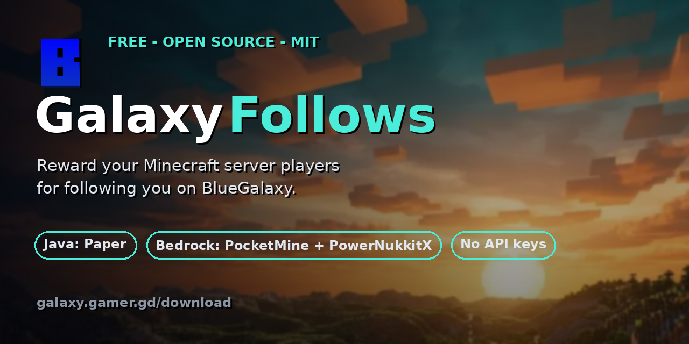
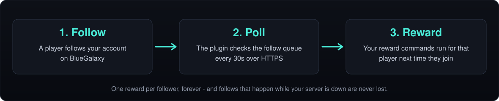
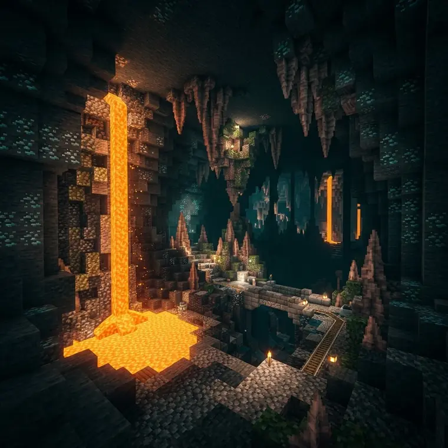

<a href="https://galaxy.gamer.gd/download"></a>

<div align="center">

[](LICENSE)
[](java/)
[](bedrock/)
[](#why-you-can-trust-it)

**Reward players on your Minecraft server when they follow your [BlueGalaxy](https://galaxy.gamer.gd) account.**
Java and Bedrock. Free, MIT licensed, fully open source.

[Download](https://galaxy.gamer.gd/download) &bull; [How it works](#how-it-works) &bull; [Install](#install) &bull; [Building](#building)

</div>

## How it works



Someone follows you on BlueGalaxy - your server runs your reward commands the next time that player joins (instantly if they are already online). The queue lives on BlueGalaxy, so follows that happen while your server is down are never lost.

## Editions

<table>
  <tr>
    <td width="50%" align="center" valign="bottom">
      <a href="java/"></a><br>
      <b>Java</b><br>
      <sub>Paper 1.21 up to 26.x - one universal build<br><code>java/</code> (Maven, JDK 21+)</sub>
    </td>
    <td width="50%" align="center" valign="bottom">
      <a href="bedrock/"></a><br>
      <b>Bedrock</b><br>
      <sub>PocketMine-MP 5 (PHP) + PowerNukkitX 3.x<br><code>bedrock/</code></sub>
    </td>
  </tr>
</table>

Ready-made downloads (jar, phar, and install notes) live at **[galaxy.gamer.gd/download](https://galaxy.gamer.gd/download)**, with a 60-second tutorial video.

## Why you can trust it

- **No keys, no secrets, no sign-up.** The only account setting in the config is your BlueGalaxy username. There is no API key, no token, no credential file, nothing to leak.
- **Fully open source.** You are reading the whole plugin. It only talks to the BlueGalaxy API over HTTPS and runs your own reward commands.
- **Unfollow proof.** By default a follow only pays after it has existed for 24 hours, and the follow is re-checked at reward time. Follow and unfollow five minutes later: no reward, ever.

## Install

1. Drop the plugin in your server's `plugins/` folder (PocketMine: PM5 only loads `.phar` files - package the source as a phar first, see the Bedrock build notes below).
2. Start the server once. A `config.yml` is generated next to the plugin.
3. Set your BlueGalaxy username and your reward commands:

```yaml
galaxyfollows:
  enabled: true
  prefix: "&d[GalaxyFollows]&r "
  username: "your_name"          # the account whose followers get rewards
  reward-commands:
    - "give {player} diamond 1"
    - "lp user {player} parent set follower"
  reward-message: "&bYou got a reward for following &f{account}&b!"
  follow-hold-hours: 24           # unfollow protection, 0 = instant
  poll-interval-seconds: 30
  max-age-days: 30
```

4. Run `/galaxyfollows reload`. Done.

## Commands

- `/galaxyfollows status` - polls, queue depth, rewards delivered
- `/galaxyfollows reload` - reload the config

## Building

Java (needs JDK 21+):

```sh
cd java && mvn clean package
```

PowerNukkitX 3.x (needs JDK 21+ and the PowerNukkitX jar for the classpath):

javac -cp powernukkitx.jar -d classes \
  bedrock/powernukkitx/net/bluenetwork/galaxyfollows/*.java
jar --create --file GalaxyFollows-1.2.0-powernukkitx.jar -C classes . \
  -C bedrock/powernukkitx plugin.yml -C bedrock/powernukkitx config.yml

Boot-tested on PowerNukkitX 3.0.5 (Bedrock 1.26.50): enable, /galaxyfollows status, clean shutdown. The 3.x API is `org.powernukkitx` (not `cn.nukkit`), so builds targeting old Nukkit-family servers are a separate, older code line and not shipped.

PocketMine: plain PHP, no build step - but PocketMine-MP 5 only loads `.phar` files (it ignores loose source folders). Package it like this:

```
mkdir pkg/GalaxyFollows/src pkg/GalaxyFollows/resources
cp -r bedrock/pocketmine/bluenetwork pkg/GalaxyFollows/src/
cp bedrock/pocketmine/config.yml pkg/GalaxyFollows/resources/config.yml
cp bedrock/pocketmine/plugin.yml pkg/GalaxyFollows/
php -d phar.readonly=0 -r '$p = new Phar("GalaxyFollows.phar");
  $p->buildFromDirectory("pkg/GalaxyFollows");
  $p->setStub("<?php __HALT_COMPILER();");'
```

Then drop `GalaxyFollows.phar` into your `plugins/` folder. Boot-tested on PocketMine-MP 5.44.3 / PHP 8.4: enable, live API poll, /galaxyfollows status, clean shutdown.

## License

MIT. See `LICENSE`. Updating for newer Minecraft versions? Read `UPDATING-VERSIONS.md`.
